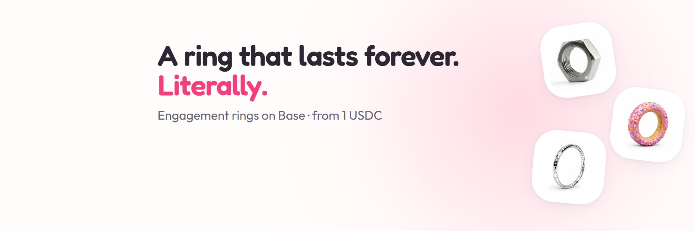
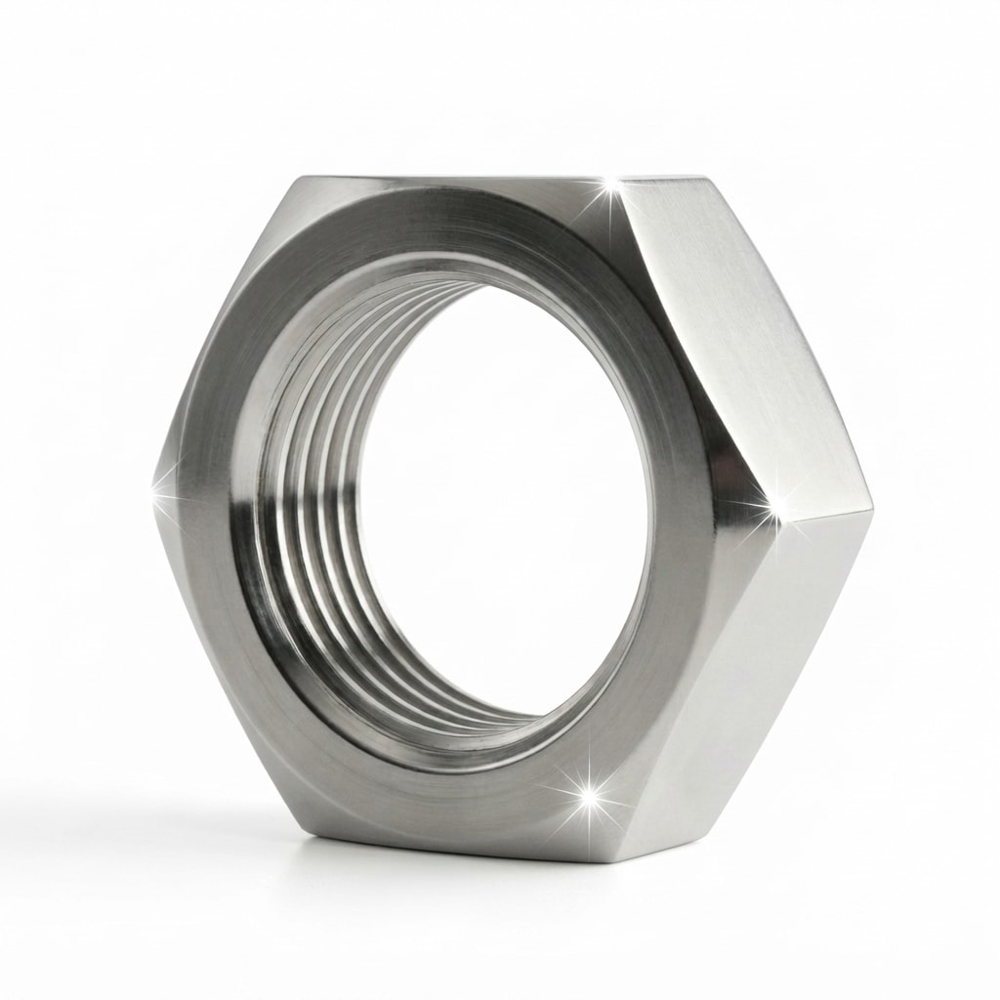
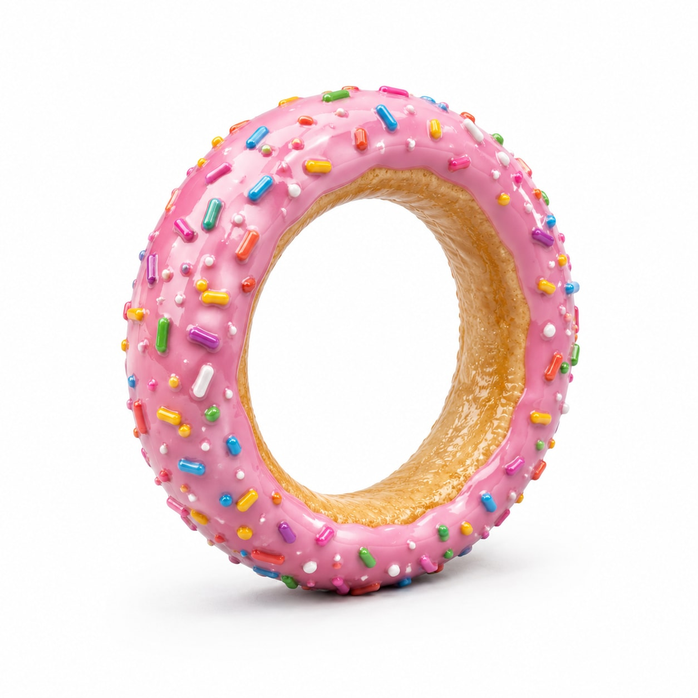
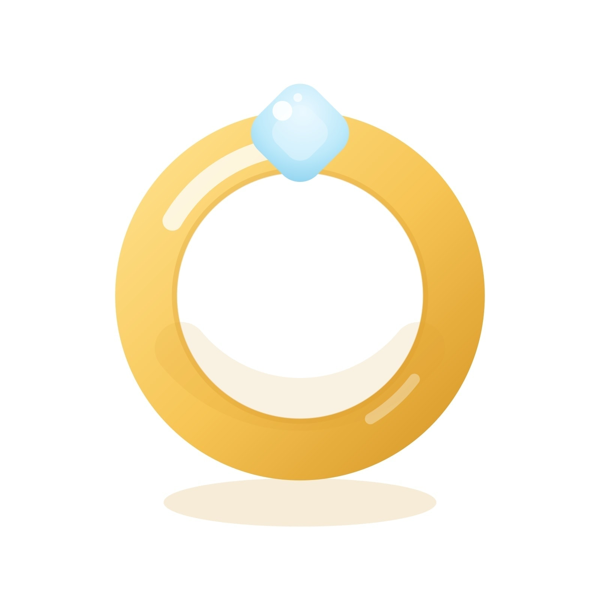
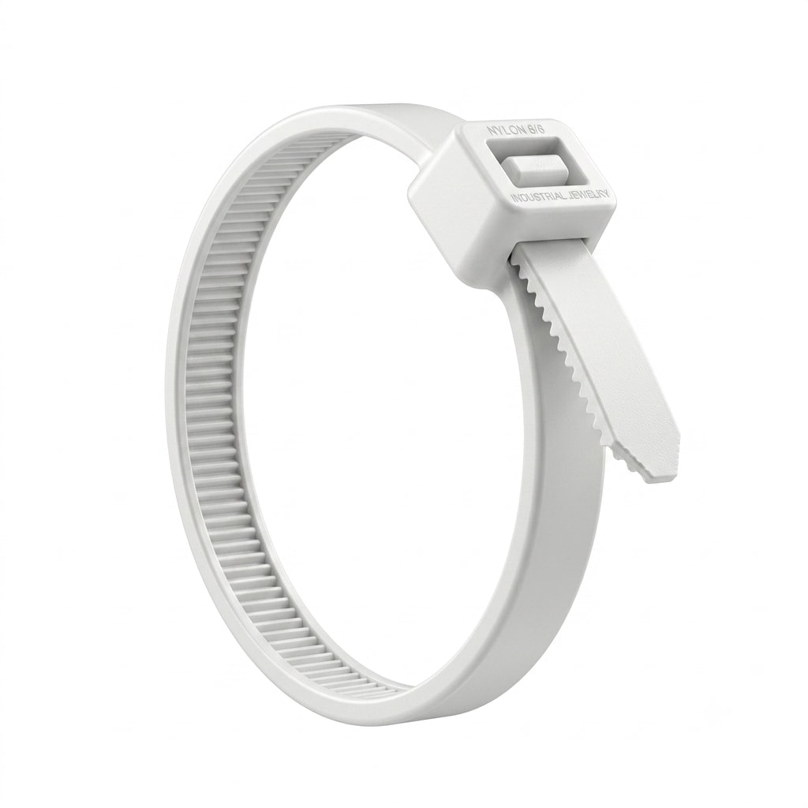
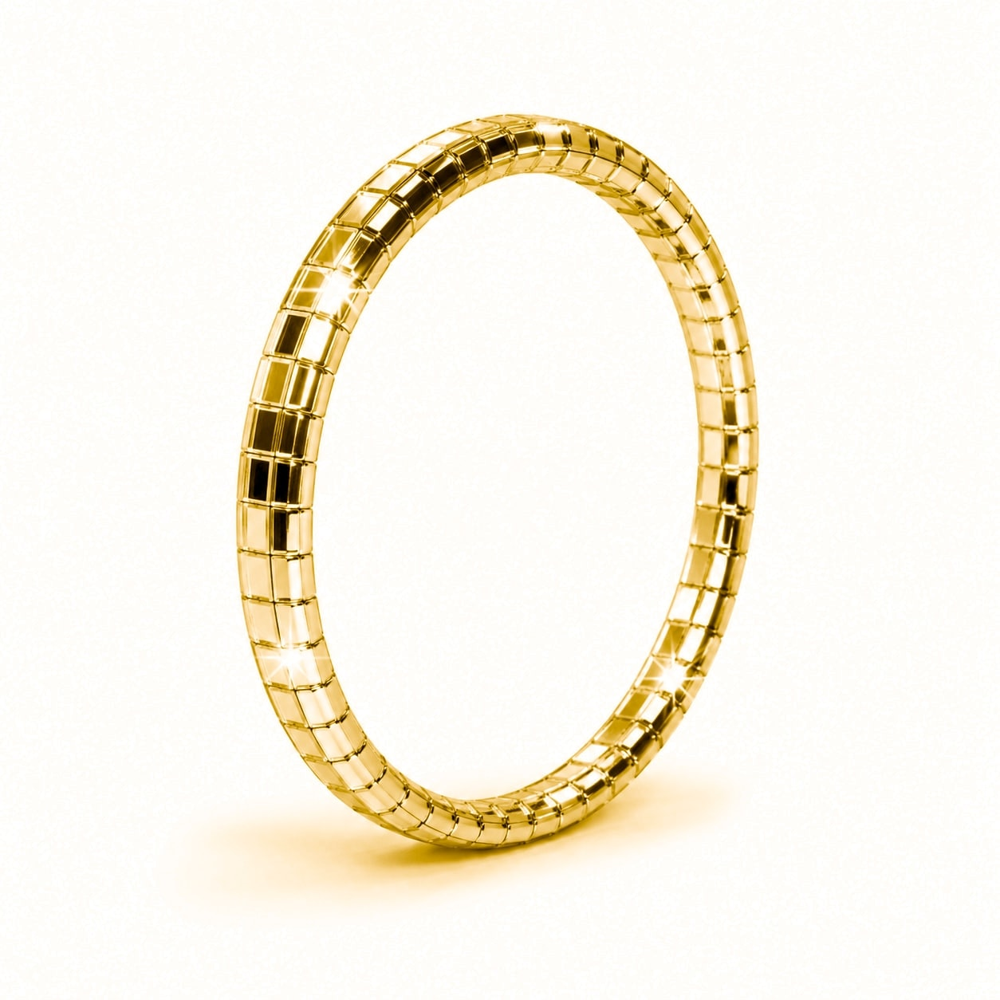
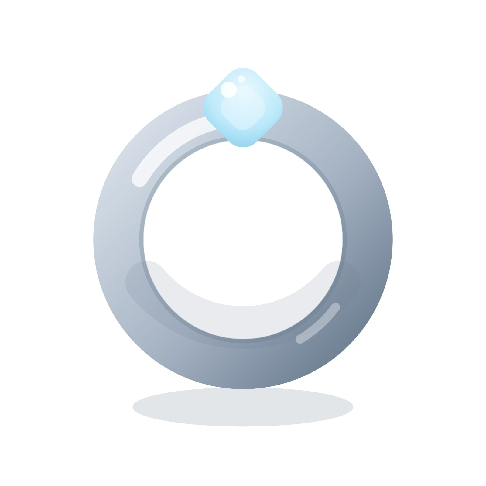
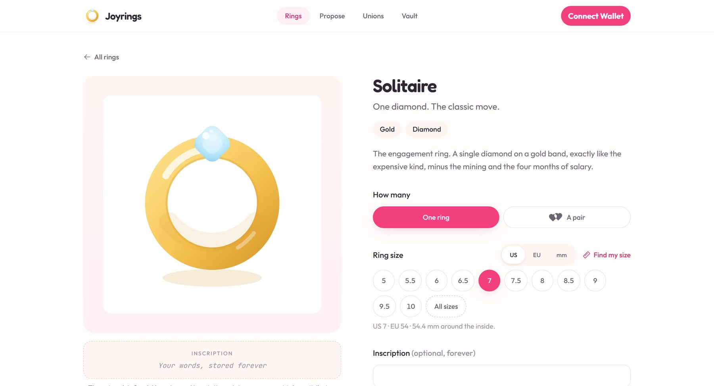
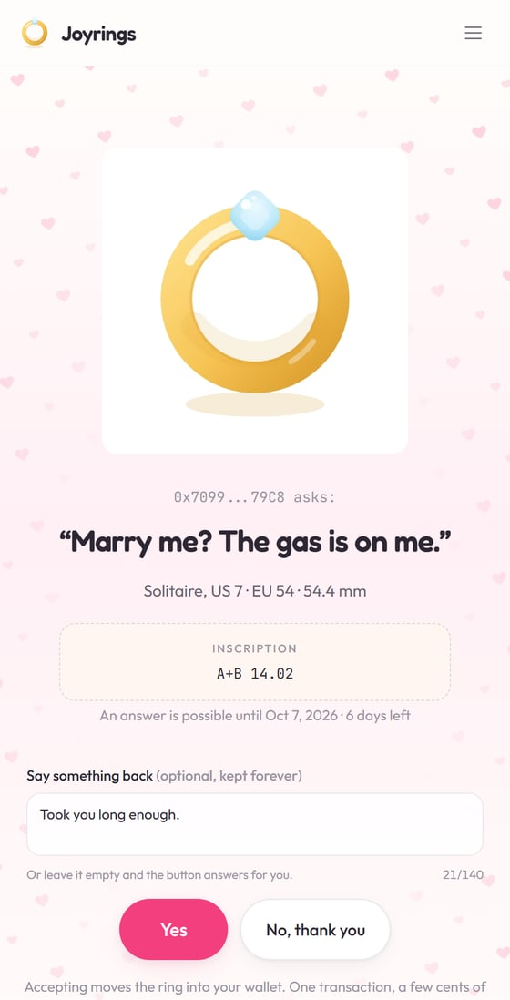
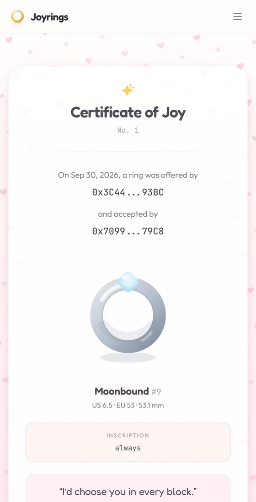

  

# Joyrings

Some questions deserve to be kept forever.

Joyrings is a shop of engagement rings that live on the blockchain. Pick a ring, write a
few words, and ask with a link. The person you ask says yes with Face ID: no wallet, no
crypto, nothing to install. Their answer is written down for good, in a numbered
**Certificate of Joy** that no one can edit, lose or take back.

The moment someone says yes is the most important few seconds of a life together, and it
usually leaves almost nothing behind. A photo, maybe. A ring that can slip down a drain.
Joyrings keeps the rest: your size, your inscription, the question and the answer.

## The rings

Rings are priced in dollars (USDC), from 1 to 20. A 1-dollar ring stays a 1-dollar ring
however the crypto market feels that day. The price was never the point. The person you
are asking is.

<table>
  <tr>
    <td align="center" width="33%">
       
      <b>Hex Nut</b> · 1 USDC 
      Six flat sides, one thread, zero pretense.
    </td>
    <td align="center" width="33%">
       
      <b>Donut Glaze</b> · 5 USDC 
      Sweet, sticky, and strictly zero calories.
    </td>
    <td align="center" width="33%">
       
      <b>Solitaire</b> · 15 USDC 
      One diamond. The classic move, minus the mining.
    </td>
  </tr>
  <tr>
    <td align="center">
       
      <b>Zip Tie White</b> · 2 USDC 
      Goes on once. Comes off with scissors.
    </td>
    <td align="center">
       
      <b>Disco Ring</b> · 11 USDC 
      Studio 54 for your finger.
    </td>
    <td align="center">
       
      <b>Moonbound</b> · 20 USDC 
      Platinum and diamond. Limited to 500.
    </td>
  </tr>
</table>

36 rings in six collections, from a gold solitaire to a zip tie. Every one is minted with
the buyer's own size and inscription, so no two are the same past the artwork.

## How it works

  

**1. Pick a ring.** Choose a design, a size and a few words for the inside. Not sure of
their size? Hold a ring they already wear against your screen: the ruler calibrates
itself with any bank card, so it is millimetre-true on any display.

  
  &nbsp;&nbsp;
  

**2. Ask with a link.** Write your question, set a deadline and send the link. They
open it, make a wallet with Face ID in seconds, and answer. The gas is on us. While you
wait, the ring is locked: you cannot sell it or promise it to anyone else.

**3. Keep the answer.** A yes writes a Certificate of Joy, numbered in the order people
said yes. A no, or silence past the deadline, quietly returns the ring to you. No hard
feelings on-chain.

Screens from the prototype. Each part opens on the testnet in its own week, see
the roadmap below.

## The little things

- **Any language, emoji included.** Inscriptions are counted in real characters, not
  bytes, so "навсегда", "永远" and "💍" are all treated the same.
- **The "no" is always polite.** You can word their yes however you like. The other
  button always says "No, thank you", and that one is ours on purpose.
- **Not only weddings.** Move in with me. Best friends. Be our godparent. Be my
  co-founder. Ten questions, each with its own room, and they can answer in their own
  words.
- **Witnesses.** A wedding needs two. A Joyrings certificate takes everyone who loves
  you: friends sign it with a wish, gas-free.
- **Pairs and gifts.** Two rings in two sizes with one inscription, 10% off. Or send a
  ring straight to someone's wallet as a gift.
- **The certificate stays with you.** Sell the ring someday and the certificate stays
  with the two of you. The promise is not a tradable asset.
- **A quiet thank-you.** If a friend buys through your link, 10% goes to you. Same price
  for them. No leaderboards, no points, ever.

## Made to outlast us

Everything you choose is written into the ring itself, on the blockchain, not into our
database. If this website disappeared tomorrow, your ring, your size and your words would
not.

The contract has no upgrade switch. Once it is on Base mainnet it can never be changed,
by anyone, including us. That is the whole promise, so it is built to keep it:

- **Permanent:** your size, your inscription, every question that was answered, every
  certificate and every witness.
- **Ours to change:** prices, new designs, and where the artwork is hosted.
- **Never ours to change:** anything you wrote.

The contract never holds money either. Every sale goes straight to the treasury, so there
is no pot of funds inside it for anyone to steal.

## Roadmap

The contract is already on the Base Sepolia testnet with every feature in it, verified
and readable by anyone on
[BaseScan](https://sepolia.basescan.org/address/0xCF98Ee83d6704a6CC2fB8c59FfD126053070B51B#code).
The site opens it one piece a week, and each Monday's progress is posted as `#ShipLog`
on [X](https://x.com/0xjoyrings).

| Opens | What | |
|---|---|---|
| Oct 12 | Mint a ring | ✅ on testnet |
| Oct 19 | Metadata built on-chain, artwork on IPFS | |
| Oct 26 | The shop and the fitting room | |
| Nov 2 | Ask the question | |
| Nov 9 | The Certificate of Joy | |
| Nov 16 | Say yes with Face ID, no wallet needed | |
| Nov 23 | Witnesses | |
| Nov 30 | Not only weddings | |
| Dec 7 | Pairs, gifts and the thank-you | |
| December | Security checks and a public bug bounty | |
| Before Christmas | **Base mainnet**, in time for proposal season | |

Building it? The technical side is in [DEVELOPMENT.md](DEVELOPMENT.md).

## License

- Source code: MIT, see [`LICENSE`](LICENSE).
- Ring artwork, the name and the logo: all rights reserved, with a display license for
  ring holders, see [`LICENSE-ART.md`](LICENSE-ART.md).
